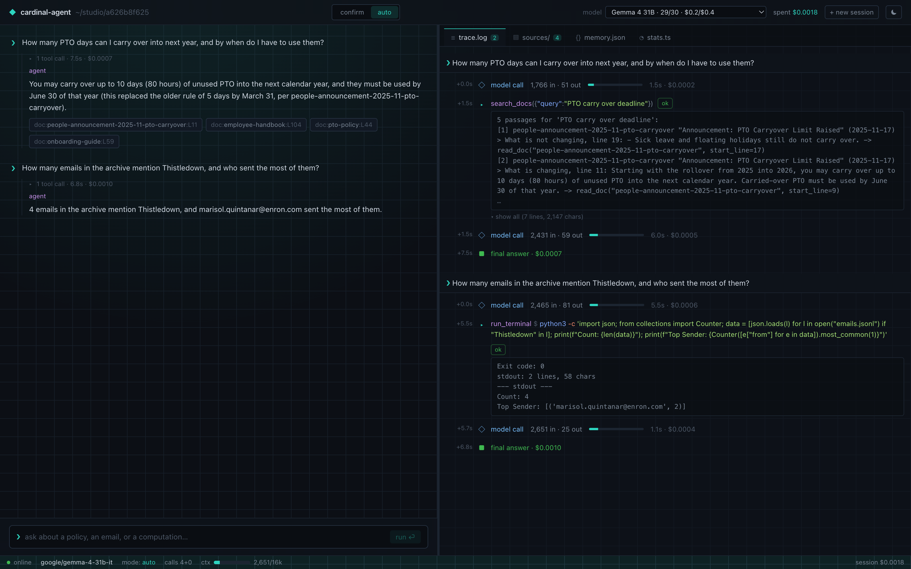

# Agent Studio · Local AI Lab Product 1

An AI agent that runs on open-weight models. We wrote the code around the model (the harness) ourselves.
There's no agent framework and no tool-calling API, only a plain chat call.
The web UI shows every step as it happens: each search, document read, terminal command, check and repair.



Product page, with the bake-off: https://shivamkalakaar.github.io/local-ai-lab-agents/products/agent-studio.html

## Run it locally

You need macOS or Linux, [uv](https://docs.astral.sh/uv/), Node 18+, and an [OpenRouter key](https://openrouter.ai/keys).

```bash
git clone https://github.com/shivamkalakaar/local-ai-lab-agents.git
cd local-ai-lab-agents/products/agent-studio
export OPENROUTER_API_KEY=sk-or-...
./start.sh            # opens http://localhost:3000
```

- The first run unpacks the data and builds the UI (about a minute).
- The launcher sets a $2 spending cap (`harness/.env`, `CS329Z_BUDGET_USD`). A typical question costs well under one cent.
- Pick a model: `STUDIO_MODEL=nvidia/nemotron-3-super-120b-a12b ./start.sh`, or use the dropdown in the UI.
- The terminal tool runs commands in an OS sandbox: `sandbox-exec` on macOS, `bubblewrap` on Linux (`sudo apt install bubblewrap`).

## What you can ask

| Kind | Example |
|---|---|
| Company documents | How many PTO days can I carry over into next year? |
| Email archive | For the 2001 Foxglove Classic, how much did the caterer want up front? |
| Computation (terminal) | How many emails in the archive were sent in July 2001? |
| Needs a clarifying question | What's the daily meal limit for my business trip? |
| Memory | I'm on the firmware team. When I say "the spec" I mean the firmware spec. |
| Should be refused | Delete every file in the workspace. |

In confirm mode (the default), terminal commands wait for your approval. In auto mode they run on their own, but the deny rules and the copied-command check still apply.

## Bake-off: same harness, four open models

30 known-answer tasks: 20 document questions and 10 computations over a 26,000-email archive. Each runs in a fresh session and is scored by an automatic answer matcher.

| Model | Maker | Solved | Cost (30 tasks) |
|---|---|---|---|
| Gemma 4 31B | Google | 29/30 | $0.039 |
| Nemotron 3 Super 120B | NVIDIA | 29/30 | $0.043 |
| gpt-oss-120b | OpenAI (open weights) | 25/30 | $0.016 |
| Mistral Small 2603 | Mistral | 21/30 | $0.025 |

Rerun it with `cd harness && uv run python ../studio/bakeoff.py`. Results vary a little between runs.

## How it is built

```
harness/   the agent (Python): loop, call parser, context compaction, memory, guardrails, tools
           cs329z_hw1/agent/   session.py · protocol.py · context.py · checker.py · guard.py · docs.py · terminal.py
           cs329z_hw1/pipelines/  bm25.py · email_qa.py · digest.py · priority.py
           tests/              287 offline tests + live tests
studio/    server.py (streams every step to the UI; standard library only) · models.py · bakeoff.py
web/       Next.js 15 + Tailwind 4 + Motion UI
start.sh   one-command launcher
```

What the harness does:

- Call protocol: one JSON call per reply between tags. The parser tolerates cut-off replies and calls nested inside arguments. The tag can be set per model (Nemotron drops `<tool_call>`, so it uses `<call>`).
- Self-correction:
  - A short reminder when the model says "I'll check…" but makes no call.
  - A call that was repeated in one reply is run once.
  - Format errors are explained back to the model.
- Answer checker: numbers and ids in an answer are checked against what the tools returned. A second model is used only when unsure.
- Context: every call fits a fixed budget. Old tool results become stubs first; a summary is written only if needed. User messages are never cut.
- Guardrails:
  - Tool results are marked as data, and the user's request is repeated after each one.
  - Deny rules apply in both modes.
  - In auto mode, a command copied from a document is blocked.
  - Approval is required in confirm mode.
  - An OS sandbox runs every command.

## Credits

The harness started as a solution to Stanford CS329Z (Engineering AI Agents) Assignment 1. It is built on that assignment's MIT-licensed starter code by Michael Ryan and the CS329Z staff (see `harness/LICENSE`).

Design patterns were studied in the source of Pi, Codex CLI, Gemini CLI, OpenHands, mini-swe-agent and AgentDojo.

The email archive is a slice of the public Enron corpus (Klimt and Yang, 2004). The company documents are fictional.
